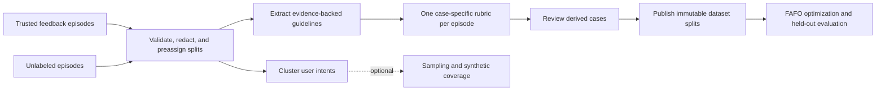

<!--
Copyright 2026 Cisco Systems, Inc. and its affiliates

SPDX-License-Identifier: Apache-2.0
-->

# Fully Automated Flow Optimization (FAFO)

[](LICENSE)
[](https://github.com/cisco-foundation-ai/fully-automated-prompt-optimization/actions/workflows/ci.yml)
[](https://arxiv.org/abs/2606.19605)

FAFO optimizes multi-step LLM pipelines. It evaluates a pipeline on a dataset,
finds the step that caused each failure, proposes one scoped change (prompt,
agent skill, parameter, or chain structure), and keeps the change only if it
improves the held-out score.

The optimizer is either:

- **A coding agent.** Claude Code or Codex drives the loop using the agent
  prompts in `.claude/` or `.codex/`. All optimization levels are available.
- **The headless optimizer.** `python -m hephaestus.cli optimize` runs the loop
  with API credentials only, for prompt and parameter changes. Use it where no
  coding agent is available, such as in production.

On top of the optimization loop, the FAFO data pipeline turns agent traces and
sparse user feedback into evaluation datasets with case-specific rubrics.
Together they form an end-to-end recursive self-improvement (RSI) loop: collect
traces, build datasets, optimize the agent, deploy it, and repeat. A local UI
shows the results.

Demo: <https://youtu.be/QG5mFbypNaI> · Paper: [arXiv:2606.19605](https://arxiv.org/abs/2606.19605)

Blog posts:

- [Fully Automated Prompt Optimization](https://cisco-foundation-ai.github.io/blogs/fully-automated-prompt-optimization/):
  the Claude Code-driven optimization loop and its benchmark results.
- [Optimize your agents with FAPO and the Explorer UI](https://cisco-foundation-ai.github.io/blogs/optimize-and-visualize-with-fapo/):
  running optimization and tracking its progress in the Explorer UI.
- [From Prompt Optimization to a Recursive Self-Improvement Framework](https://cisco-foundation-ai.github.io/blogs/fafo-recursive-self-improvement/):
  turning sparse user feedback into evaluation rubrics for continuous agent improvement.

## Contents

- [How it works](#how-it-works)
- [Quick start](#quick-start)
- [Core concepts](#core-concepts)
- [Optimization](#optimization)
- [Building evaluation datasets from traces](#building-evaluation-datasets-from-traces)
- [Guarantees and limits](#guarantees-and-limits)
- [CLI reference](#cli-reference)
- [Agent prompt sets](#agent-prompt-sets)
- [Troubleshooting](#troubleshooting)
- [Development](#development)
- [Documentation](#documentation)
- [Citation](#citation)

## How it works

```text
1. Evaluate   run the chain on a dataset; record every step's output; score each case
2. Attribute  localize each failure to a step and to the kind of change that can fix it
3. Propose    write one scoped variant: prompt, skill, parameter, or chain structure
4. Review     check the variant for leakage, placeholder drift, and scope violations
5. Compare    evaluate the variant and keep it only if it beats the current best
6. Iterate    continue at this level, or escalate when text changes stop helping
```

Pipelines are [LangGraph](https://langchain-ai.github.io/langgraph/) graphs whose
nodes each write a named output, so a failure can be traced to retrieval,
reasoning, or formatting instead of only to the final answer. FAFO starts with
the cheapest change (prompt text) and escalates to parameters or chain structure
only when attribution shows that text cannot fix the remaining failures.

The loop needs a dataset to evaluate against. You can write one by hand, or let
the [FAFO data pipeline](#building-evaluation-datasets-from-traces) build it from
production agent traces and feedback, which turns optimization into a
self-improvement cycle.

FAFO's baseline is the GEPA prompt optimizer:

| | GEPA | FAFO |
|---|---|---|
| **Action space** | Instruction text inside a fixed chain | Prompt text, agent skills, chain parameters, and chain structure |
| **Search** | Evolutionary search over prompts | Attribution-driven scoped edits, escalating only when needed |
| **Failure signal** | Final-score feedback | Step-level attribution over recorded intermediate outputs |

Both start from the same pipeline and baseline prompts. FAFO does not depend on
GEPA or DSPy; see the paper for benchmark results.

## Quick start

### 1. Install

```bash
python -m venv .venv && source .venv/bin/activate
pip install -e .
```

### 2. Define a tenant

A **tenant** is one optimization project: a dataset, a chain, a scorer, a prompt,
and a config that ties them together. Real tenants live in `tenants/<tenant_id>/`;
this example keeps the files in one directory.

**Dataset** (`my_dataset.jsonl`), one case per line:

```json
{"case_id": "1", "task_type": "qa", "context": {"question": "What is the capital of France?"}, "expected": {"answer": "Paris"}, "metadata": {}}
{"case_id": "2", "task_type": "qa", "context": {"question": "What is 2 + 2?"}, "expected": {"answer": "4"}, "metadata": {}}
```

**Chain** (`my_chain.py`), a LangGraph pipeline:

```python
from langgraph.graph import StateGraph, END
from src.hephaestus.chains.types import ChainState
from src.hephaestus.chains.nodes import make_llm_node

def build_chain(provider, config):
    graph = StateGraph(ChainState)
    graph.add_node("answer", make_llm_node(
        provider=provider,
        prompt_template_path=config["prompt_paths"]["answer"],
        output_key="answer",
    ))
    graph.set_entry_point("answer")
    graph.add_edge("answer", END)
    return graph.compile()
```

**Scorer** (`my_scorer.py`):

```python
from src.hephaestus.scoring.scorer import Scorer as BaseScorer

class Scorer(BaseScorer):
    def validate_case(self, case, scoring_profile):
        assert "answer" in case.expected, "Missing 'answer' in expected"

    def score_case(self, case, output_text, scoring_profile):
        em = 100.0 if output_text.strip().lower() == case.expected["answer"].strip().lower() else 0.0
        return {"composite_score": em, "score_breakdown": {"exact_match": em}}
```

**Prompt** (`prompt.md`):

```text
System: You are a helpful assistant. Answer concisely in as few words as possible.

User: ${question}
```

**Config** (`eval.json`):

```json
{
  "tenant_id": "my_project",
  "provider": "openai",
  "provider_settings": { "model": "gpt-4o", "temperature": 0.0, "max_tokens": 1024 },
  "dataset": { "path": "my_dataset.jsonl" },
  "chain": {
    "path": "my_chain.py",
    "fn": "build_chain",
    "config": { "prompt_paths": { "answer": "prompt.md" } }
  },
  "scoring_profile": { "scorer": { "module_path": "my_scorer.py", "class_name": "Scorer" } },
  "output_dir": "eval_output/"
}
```

### 3. Run a baseline eval

```bash
export OPENAI_API_KEY="<your-openai-api-key>"
python -m hephaestus.cli eval --config eval.json
cat eval_output/summary.md
```

### 4. Optimize

**With Claude Code**, from the repository root:

```text
> /optimization
  → Tenant: my_project
  → Config: eval.json
  → Success criteria: composite_score >= 90
```

**With Codex**, give the same tenant, config, and success criteria and ask it to
follow `.codex/agents/optimization.md`.

**Without a coding agent**, split the dataset into `train.jsonl`, `val.jsonl`,
and `test.jsonl`, and write a policy that states what may change
(`optimize-policy.json`):

```json
{
  "base_config": "eval.json",
  "datasets": { "train": "train.jsonl", "val": "val.jsonl", "test": "test.jsonl" },
  "levels": ["prompt"],
  "budget": { "max_iterations": 10 },
  "roles": { "model": "<openai-model>" }
}
```

```bash
python -m hephaestus.cli optimize --policy optimize-policy.json --workspace optimize_output/ --final-test
```

New prompt variants are written next to `prompt.md`. The run prints baseline and
best scores and writes `optimize_output/best-config.json`, a runnable eval config
for the best variant.

The agent or headless optimizer is separate from the **task model** it
optimizes, which is whatever you set in `provider_settings.model` (here `gpt-4o`).

## Core concepts

### Project layout

```text
src/hephaestus/       # generic engine: chains, providers, scoring, runs, analysis, optimization
tenants/<tenant_id>/  # one project: chains/, prompts/, skills/, datasets/, code/, configs/, docs/, evals/
docs/                 # architecture, processes, and references
tests/                # automated tests
```

Everything in `src/hephaestus/` is generic; everything tenant-specific lives in
`tenants/<tenant_id>/`. Each tenant also keeps docs, including an
`iteration-playbook.md` that sets its optimization scope and success criteria.
See the [tenant docs contract](docs/tenant-docs-contract.md) and the
[templates](docs/templates/tenant-docs/).

### Datasets

JSONL, one case per line, with five required fields: `case_id`, `task_type`,
`context` (inputs passed to the chain), `expected` (ground truth, read only by
your scorer), and `metadata` (free-form; may be `{}`).

### Chains and chain state

A chain is a LangGraph `StateGraph` returned by `build_chain(provider, config)`.
Nodes share a state with four protocol fields:

| Field | Type | Description |
|---|---|---|
| `context` | `Dict[str, str]` | Inputs from the dataset case |
| `output_text` | `str` | Final output, read by the scorer |
| `step_outputs` | `Dict[str, str]` | Intermediate outputs, keyed by node name |
| `diagnostics` | `List[str]` | Warnings, such as missing placeholders |

`make_llm_node` renders a prompt from `context` and earlier step outputs, calls
the provider, and writes the response to `output_text` and
`step_outputs[output_key]`.

### Prompt templates

```text
System: You are a helpful assistant.

User: Question: ${question}
Context: ${steps.retrieve.output}
```

`${name}` is filled from `context`; `${steps.<node>.output}` is filled from an
earlier node. Missing variables are logged as diagnostics, not errors. Every
change is a new file, `prompts/modules/<module>/variant-NNN.md`; variants are
never edited in place.

### Scorers

Subclass `Scorer` and implement `validate_case` and `score_case`. `score_case`
returns a finite `composite_score` in `[0, 100]`, the objective the optimizer
drives, and a numeric `score_breakdown` for any extra metrics. A multi-step scorer
can override `score_pipeline_case(case, step_outputs, scoring_profile, output_text)`
to score intermediate outputs.

### Providers

| Provider | `provider` value | Credential |
|---|---|---|
| OpenAI | `"openai"` | `OPENAI_API_KEY` |
| Baseten | `"baseten"` | `BASETEN_API_KEY` |
| SageMaker | `"sagemaker"` | Environment variable named by `api_key_env` |

Model, sampling, timeout, and retry settings go in `provider_settings`; see the
[config schema](docs/config-schema.md).

### Skills

Tool-using (MCP) tenants can also optimize **skills**: reusable procedures stored
at `tenants/<tenant_id>/skills/<name>/variant-NNN.md`, listed in
`chain.config.skill_paths`, and iterated like prompts. The chain factory must
render and pass them to its agentic node; see the
[architecture](docs/architecture.md) and the [MCP quick start](docs/mcp-quick-start.md).

## Optimization

### Levels

| Level | What changes | Example | Headless |
|---|---|---|---|
| **Prompt** | Prompt template text | Add "answer in one word" | Yes |
| **Skill** | Agent skill text (agentic tenants) | Refine a tool-sequencing procedure | No |
| **Parameter** | Config values | `retrieval_k` 7 → 10, `temperature` 1.0 → 0.5 | Yes |
| **Structural** | Chain topology and nodes | Add a verification node | No |

### Step attribution

After each eval, the runtime performs deterministic, rule-based runtime
attribution over recorded step outputs, tool history, execution status, and
caller-supplied in-memory case context and expected-answer evidence; it does not
persist that joined protected evidence. It flags retrieval misses, cascading
empty steps, tool errors, and format failures. A failed case that no rule
explains gets a low-confidence final-step fallback, which does not prove that
the inputs were good or that reasoning was the cause. Format failures and
low-confidence final-step fallbacks are tagged textual (prompt- or
skill-addressable); retrieval and cascade failures are tagged structural. The
attribution table appears in `summary.md` only when the run has step outputs and
at least one failure. Any later agent semantic analysis is a separate,
tenant-governed step.

### With a coding agent

`/optimization` in Claude Code, or `.codex/agents/optimization.md` in Codex:

1. Reads the tenant playbook and states a scope contract (allowed and forbidden levels).
2. Analyzes failures after each eval, using the step-attribution subagent.
3. Writes one variant per change and has the variant-reviewer subagent check it.
4. Evaluates the variant, comparing on validation scores only, and keeps improvements.
5. Repeats until the success criteria are met or every allowed level is exhausted.

Each cycle is recorded in `tenants/<tenant_id>/docs/iteration-memory.jsonl` and
`change-log.md`, so later sessions do not repeat failed attempts. See the
[optimization loop reference](docs/processes/prompt-iteration-loop.md).

### Without a coding agent (headless)

`python -m hephaestus.cli optimize` runs the loop with a plain-code coordinator
and three LLM roles (analyst, prompt proposer, and reviewer) called through the
OpenAI API by default. The coordinator, not a prompt, enforces the rules:

- Roles see only training cases.
- Candidates are accepted on validation.
- Test runs once, at the end.
- Only the levels and parameter bounds declared in the policy can change.
- A static review blocks leaked training examples, placeholder drift, and prompts
  that name held-out inputs.

Every decision is appended to a resumable `ledger.jsonl`.

| | Coding agent | Headless optimizer |
|---|---|---|
| **Runs with** | Claude Code or Codex | `python -m hephaestus.cli optimize` and API credentials |
| **Levels** | Prompt, skill, parameter, structural | Prompt, parameter |
| **Scope from** | Tenant playbook (prose) | Optimization policy (JSON) |
| **Guardrails** | Agent protocol and reviewer subagent | Code checks plus a reviewer role |
| **State** | `docs/iteration-memory.jsonl` | `ledger.jsonl` (resumable) |

Results depend on the role model (`roles.model`), so use the strongest model
available. See [headless optimization](docs/processes/headless-optimization.md)
for the policy format, the roles, and the outputs.

## Building evaluation datasets from traces

Everything above assumes you already have a labeled dataset. A deployed agent
usually has traces instead: many unlabeled conversations, a few with user
feedback, and no ground-truth answers. The FAFO data pipeline is an add-on to
the optimization loop that fills this gap. It turns those traces into evaluation
datasets, so the loop can learn from the agent's real behavior:

```text
 ┌─► agent traces + user feedback
 │          │
 │          ▼   FAFO data pipeline
 │   evaluation datasets with case-specific rubrics
 │          │
 │          ▼   optimization loop (coding agent or headless)
 │   improved agent
 │          │
 └──────────┘   deploy, then collect new traces
```

The released train, validation, and test splits are the datasets the
optimization loop trains on, selects with, and tests on, under the same held-out
rules as any other dataset. A trusted regression split checks that previously
correct behavior still holds. Each deployment produces new traces and feedback,
so repeating the cycle gives recursive self-improvement. The
[recursive self-improvement post](https://cisco-foundation-ai.github.io/blogs/fafo-recursive-self-improvement/)
explains the approach and its results.

### Inside the pipeline

The pipeline needs only a small set of feedback-labeled traces and a larger set
of unlabeled traces. No chain or prompt is needed, so it can also be the first
step of a new tenant.



Guidelines come only from trusted training feedback, and each episode's rubric
uses only the guidelines its split may see. Intent clustering is optional and
used only for sampling and synthetic coverage. Derived cases are published only
after explicit review finalization.

```bash
python -m hephaestus.cli assets create --tenant <tenant_id> --asset-id v1 \
  --feedback <labeled.jsonl> --unlabeled <unlabeled.jsonl>
python -m hephaestus.cli assets run --tenant <tenant_id> --asset-id v1   # stops at awaiting_review
python -m hephaestus.cli assets reviews list --tenant <tenant_id> --asset-id v1
python -m hephaestus.cli assets reviews finalize --tenant <tenant_id> --asset-id v1 \
  --reviewer <name> --review-set <sha256:...> --decision-set <sha256:...>
```

Inputs must follow the
[`fafo-evaluation-input-v1`](docs/processes/evaluation-input-contract.md) contract.
Released splits are published under
`tenants/<tenant_id>/datasets/evaluation_assets/<asset_id>/`; point an eval
config's `dataset.path` at the exact generation file listed in the asset
manifest.

### Runtime memory cards

Released assets can also feed the agent directly. `python -m hephaestus.cli memory build`
compiles each trusted guideline and a few supporting traces into a compact
procedural card that the agent reads at runtime. This is a second way to bring
what the traces taught back into the agent; see
[runtime memory cards](docs/processes/runtime-memory-cards.md).

Further reading: the [data pipeline guide](docs/processes/feedback-dataset-flow.md)
covers concepts and the trust model; the
[evaluation asset reference](docs/references/evaluation-assets.md) covers the
workspace, stages, lifecycle, and full CLI.

## Guarantees and limits

- **Runtime-enforced controls:** config validation, unique case IDs, exclusive
  output directories, per-case execution status, successful-only score averages,
  and authenticated run bundles. The
  [canonical enforcement boundary](docs/processes/prompt-iteration-loop.md#enforcement-boundary)
  lists exactly which controls the runtime enforces.
- **Agent-loop guardrails:** train-only failure analysis, playbook scope,
  iteration memory, and variant immutability. **All four are agent-enforced / bypassable**:
  they rely on the agent following the tenant protocol. The headless optimizer
  enforces the train/held-out split, policy scope, and variant immutability in
  code.
- **Conventions:** the **prompt-first convention is recommended, not runtime-enforced**,
  as are focused edits and repeated trials for noisy metrics.
- **Isolation:** tenant directories are organizational only, not a
  runtime-enforced isolation boundary, and not an operating-system sandbox. Any
  process with filesystem access to the checkout can read or change them.

## CLI reference

| Command | Purpose |
|---|---|
| `eval --config <config>` | Run one eval and write a run bundle to `output_dir` |
| `eval-progress --output-dir <dir> [--json]` | Show a run's status, progress, and average score |
| `optimize --policy <policy> [--final-test] [--resume]` | Run the headless optimizer |
| `assets create \| run \| status \| reviews \| extend \| adopt` | Build evaluation assets from traces |
| `memory build \| build-additive` | Build runtime memory cards from a released asset |
| `customer-data pull \| push \| remove-local --tenant <id> --scope raw\|derived\|all` | Sync tenant data with GCS |
| `ui` | Start the FAFO Explorer UI |

All commands run as `python -m hephaestus.cli <command>`; add `--help` for every
option.

An eval run bundle contains `summary.md`, `results.jsonl`, `run_config.json`,
`run_identity.json`, `progress.json`, and `run_manifest.json`, which is written
last and authenticates the bundle. Score averages use successful cases only.
`results.jsonl` can repeat tenant data, so treat it as tenant data. See
[eval output paths](docs/references/eval_paths.md).

**FAFO Explorer** (`python -m hephaestus.cli ui`) is a local, read-only web UI at
<http://127.0.0.1:8765/>. It shows runs, per-case outputs, score breakdowns,
prompt and skill variants, datasets, iteration history, and tenant docs; see
[web UI](docs/web-ui.md) and the
[Explorer UI post](https://cisco-foundation-ai.github.io/blogs/optimize-and-visualize-with-fapo/).

## Agent prompt sets

Claude Code and Codex use parallel prompt sets for the same workflows:

| Workflow | Claude Code | Codex | Purpose |
|---|---|---|---|
| Optimization | `/optimization` | `.codex/agents/optimization.md` | Run the optimization loop |
| Step attribution | Dispatched by `/optimization` | `.codex/agents/step-attribution.md` | Post-eval failure analysis |
| Variant review | Dispatched by `/optimization` | `.codex/agents/variant-reviewer.md` | Guardrail check before each eval |
| Eval runner | `/eval-runner` | `.codex/commands/eval-runner.md` | Run and summarize an eval |
| Evaluation assets | `evaluation-asset-creator` agent | `.codex/agents/evaluation-asset-creator.md` | Run and monitor the data pipeline |
| Synthetic data | `/synthetic-samples`, `/synthetic-pruner` | `.codex/commands/synthetic-*.md` | Create and clean synthetic cases |
| Reset tenant | `/reset-tenant` | `.codex/commands/reset-tenant.md` | Reset a tenant to its baseline |

Repository tooling for Claude Code only: `/pr-lifecycle` and `/k8s-manager`.
`CLAUDE.md` holds repository-wide rules, including tenant data safety.

## Troubleshooting

**OpenAI SSL or certificate errors**, for example behind a corporate proxy:

1. Run `pip install --upgrade openai httpx certifi truststore`.
2. Uncomment the `truststore.inject_into_ssl()` block in
   `src/hephaestus/providers/openai.py`, `src/hephaestus/datasets/rubric_providers.py`,
   and `src/hephaestus/datasets/embedding_providers.py`.
3. Restart the process.

This only fixes certificate errors, not invalid keys, unavailable models, or rate
limits.

## Development

- Python 3.10+. Optional extras in `pyproject.toml` add local-model and
  tenant-specific dependencies.
- `python -m pytest` runs the unit tests without API keys;
  `python -m pytest -m integration` needs live API keys and GCS access.
- `make ci` runs lint, license-header and tenant-docs checks, and the tests.
- See [CONTRIBUTING.md](CONTRIBUTING.md), the [style guide](docs/style-guide.md),
  and [GitHub hygiene](docs/github-hygiene.md).

## Documentation

| Document | Covers |
|---|---|
| [Architecture](docs/architecture.md) | Eval runtime, chain execution, run artifacts |
| [Config schema](docs/config-schema.md) | Every eval config field |
| [Eval output paths](docs/references/eval_paths.md) | Run bundle lifecycle and authority |
| [Tenant model](docs/tenant-model.md) and [docs contract](docs/tenant-docs-contract.md) | Tenant layout and required tenant docs |
| [Optimization loop](docs/processes/prompt-iteration-loop.md) | Agent loop, enforcement boundary, iteration memory |
| [Headless optimization](docs/processes/headless-optimization.md) | API-only optimizer: policy, roles, outputs |
| [Chain variant conventions](docs/processes/chain-variant-conventions.md) | Structural variant naming and metadata |
| [Data pipeline guide](docs/processes/feedback-dataset-flow.md) | Traces and feedback to evaluation datasets |
| [Evaluation input contract](docs/processes/evaluation-input-contract.md) | Input JSONL format for the data pipeline |
| [Evaluation asset reference](docs/references/evaluation-assets.md) | Workspace, stages, lifecycle, full CLI |
| [Runtime memory cards](docs/processes/runtime-memory-cards.md) | Memory cards from released assets |
| [MCP quick start](docs/mcp-quick-start.md) | Agentic (tool-using) tenants |
| [Web UI](docs/web-ui.md) | FAFO Explorer |
| [Prompting guides](docs/prompting-guides/) | Prompting practices and agentic chain patterns |

## Citation

**FAPO: Fully Automated Prompt Optimization of Multi-Step LLM Pipelines**<br>
Paul Kassianik, Baturay Saglam, Huaibo Zhao, Blaine Nelson, Supriti Vijay, Aman Priyanshu, Amin Karbasi · [arXiv:2606.19605](https://arxiv.org/abs/2606.19605)

```bibtex
@misc{kassianik2026fafoflowoptimization,
      title={FAPO: Fully Automated Prompt Optimization of Multi-Step LLM Pipelines},
      author={Paul Kassianik and Baturay Saglam and Huaibo Zhao and Blaine Nelson and Supriti Vijay and Aman Priyanshu and Amin Karbasi},
      year={2026},
      eprint={2606.19605},
      archivePrefix={arXiv},
      primaryClass={cs.SE},
      url={https://arxiv.org/abs/2606.19605},
}
```

## License

Apache License 2.0; see [LICENSE](LICENSE). Copyright 2026 Cisco Systems, Inc. and/or its affiliates.
