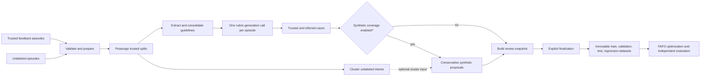

<!--
Copyright 2026 Cisco Systems, Inc. and its affiliates

SPDX-License-Identifier: Apache-2.0
-->

# FAFO Data Pipeline

> This page describes the eight-stage pipeline, which will be removed. New
> assets use `assets build`; see the [data pipeline reference](../references/data-pipeline.md).

The FAFO data pipeline turns a small set of trusted, feedback-labeled agent
episodes and a larger set of unlabeled episodes into a versioned evaluation
asset. FAFO uses the asset's cases and rubrics to evaluate prompt or skill
variants without treating an agent's historical behavior as ground truth.

Read this guide for the concepts, trust model, and stage behavior. The input
schema is the [`fafo-evaluation-input-v1` contract](evaluation-input-contract.md).
Workspace layout, durability guarantees, and the full CLI are in the
[evaluation asset reference](../references/evaluation-assets.md).

The pipeline keeps three kinds of information separate:

- **Trusted feedback** provides reusable evidence about expected behavior.
- **Complete episodes** provide case-specific facts, requests, tool
  observations, and outcomes.
- **Intent clusters** provide sampling and analysis metadata only. They do not
  determine correctness or guideline applicability.

## What the Pipeline Produces

An evaluation asset contains:

- a reusable training guideline catalog;
- one case-specific rubric for every scoreable trusted or unlabeled episode;
- trusted cases, inferred cases, and optionally synthetic cases;
- optional cluster membership and representatives for sampling;
- complete provenance and dependency fingerprints;
- held-item and review records; and
- immutable train, validation, test, and trusted-regression datasets.

The asset defines evaluation requirements. A downstream judge must still score
a candidate agent's newly produced trajectory against each case rubric. The
historical assistant response is evidence for authoring, not the response FAFO
should optimize toward.

## Inputs

Asset creation requires two nonempty JSONL files:

| Input | Required contents | Role |
|---|---|---|
| Trusted feedback | Complete episode, assistant output, and feedback polarity; rationale or checks when available | Extract reusable guidelines and create trusted case rubrics |
| Unlabeled traffic | Complete episode without feedback | Represent real traffic and create inferred case rubrics |

Every row must conform to
[`fafo-evaluation-input-v1`](evaluation-input-contract.md). Core fields include
`record_id`, `group_id`, `task_type`, `user_input`, `conversation_context`,
`tool_calls`, `runtime`, and `metadata`. Feedback rows also require an
`assistant_output` and feedback with a polarity; rationale is optional. The
optional `episode` field preserves the complete ordered sequence of messages,
tool calls, and tool results, including call/result linkage.

Source files must be ordinary `.jsonl` files beneath the selected tenant's
`source_artifacts/` or normal `datasets/` directory. Cross-tenant paths,
symlink escapes, generated evaluation-asset outputs, and external paths are
rejected. After creation, every stage reads the copied inputs inside the asset
workspace, not the original source files.

### Feedback eligibility

A trusted row with a valid feedback polarity can influence guideline creation
and receive a trusted case rubric. A nonempty rationale, material correction,
or declared deterministic or executable check gives the authoring model more
specific evidence. With polarity alone, the model must preserve uncertainty
about the cause of the rating and ground requirements in the explicit request
and observable trace.

### Intent text

The clustering embedding is built from all user messages in episode order,
including repeated messages. Episode messages are authoritative when
available; otherwise the canonical user-facing fields are used.

Assistant messages, tool arguments, and tool results are excluded from the
embedding text because they describe what the historical agent did, not just
what the user intended. Tool names may be kept as structural metadata but are
not part of the intent embedding.

## Trust and Evidence Model

| Evidence | What it can establish | What it cannot establish by itself |
|---|---|---|
| Trusted user or SME feedback | A supported success, error, or expected repair | Facts not stated or supported by the episode |
| Tool call | The action the agent attempted | That the action was appropriate or succeeded |
| Tool result | The outcome the environment reported | That the agent chose the correct action |
| Runtime/environment event | An observed execution condition | Agent culpability without supporting evidence |
| Historical assistant response | What the agent said or did | The correct answer merely because it occurred |
| Unlabeled trace | Case facts and observed outcomes | New reusable policy or correctness truth |

The pipeline distinguishes agent behavior from environment failure and records
uncertainty when causality is not supported. It never silently turns observed
behavior into a rule.

## Step-by-Step Flow



| Stage | Behavior | Main outputs |
|---|---|---|
| 1. `raw_inputs` | Copy both sources into a self-contained asset; validate, count, and hash them; validate cluster feasibility when clustering is enabled | Copied source JSONL and validation receipt |
| 2. `prepared_inputs` | Redact content, normalize defaults, check IDs, derive split-isolation groups and assign trusted splits, assess feedback eligibility, and construct user-message intent text | Normalized records, intent records, eligibility and split plans |
| 3. `rubric_extraction` | Extract trace-grounded evidence from eligible training feedback only and consolidate compatible evidence into reusable guidelines; compile protected guidance separately | Public guideline catalog, protected guideline artifacts, evidence and candidate inventories |
| 4. `intent_clustering` | Optional. Embed unlabeled intent text and run deterministic route-local clustering for later sampling and analysis | Cluster assignments, representatives, top terms, embedding metadata; empty inventory when disabled |
| 5. `coverage_decisions` | Optional. Persist cluster sampling context only; make no policy, matching, support, or correctness decisions | `cluster_sampling_metadata.jsonl`; empty when disabled |
| 6. `label_inference` | Make exactly one rubric-generation call per episode with the full split-permitted catalog and complete episode evidence; the call selects applicable guidelines and writes a case-specific rubric | Episode rubrics, trusted/inferred cases, dependencies, held outputs |
| 7. `synthetic_coverage` | Optionally generate conservative synthetic proposals and apply mechanical filters; then form exact-context families, fingerprint eligible items, auto-approve scoreable derived cases, and build the fingerprinted review snapshot | Synthetic artifacts, review decisions, holds, dependencies |
| 8. `dataset_splits` | After explicit finalization, publish trusted plus approved derived cases as immutable splits, excluding held or rejected items | Immutable datasets and release manifest |

The persisted Stage 3 enum remains `rubric_extraction` for compatibility. Its
product is evaluation guidelines, and its canonical directory is
`03_evaluation_guidelines`.

### Stage 2: Split Isolation Before Authoring

Stage 2 derives a `split_group_id` while preserving the supplied `group_id`.
Records connected by exact canonical model-visible context or a supplied group
are assigned together. Before any guideline or rubric model call, trusted
connected components are deterministically assigned from the split seed:

| Trusted partition | Hash interval | Approximate target |
|---|---:|---:|
| `regression_trusted` | `[0.00, 0.20)` | 20% |
| `train` | `[0.20, 0.68)` | 48% |
| `validation` | `[0.68, 0.84)` | 16% |
| `test` | `[0.84, 1.00)` | 16% |

Actual counts can differ because connected groups are indivisible. Derived
families not attached to a trusted split use a deterministic 60/20/20
train/validation/test assignment, but derived cases never enter
`regression_trusted`: a derived case connected to regression is held instead.

This ordering keeps test and regression feedback from becoming reusable
training guidance. Protected feedback may be used only to author the rubric for
its owning held-out episode. Except for that single Stage 6 call, isolation
controls never expose protected criteria to Stages 5–7, later provider payloads, or API previews
for any other record.

### Stage 3: Guideline Extraction

#### Evidence extraction

For each eligible training feedback episode, the model receives the feedback
and the ordered trace: assistant messages, tool calls, tool results, and
relevant runtime observations. Where the feedback supports a specific
behavioral conclusion, the model must:

1. identify the behavior praised or criticized;
2. point to the feedback and observable trace evidence;
3. describe the expected repair or preserved behavior;
4. recognize recurring mistake or success patterns when supported;
5. distinguish an agent error from an environment or tool failure; and
6. retain uncertainty instead of inventing a causal explanation.

Tool activity is first-class evidence. For example, a tool result can prove
that a mutation succeeded or failed, while detailed feedback can establish
whether attempting that mutation was appropriate. A polarity-only rating
records overall satisfaction or dissatisfaction without identifying the
responsible action or a specific repair.

#### Consolidation

Compatible evidence is merged into reusable guidelines, so 35 feedback
episodes need not produce 35 guidelines: several episodes may support the same
behavioral requirement. The catalog keeps source IDs, so every eligible
training feedback record stays traceable to the evidence it contributed.

Guidelines should be specific enough to judge behavior but reusable across
cases. They must not copy accidental details, create unsupported policy, or
collapse conflicting evidence into a falsely certain rule.

#### Protected held-out guidance

Validation, test, and regression feedback is processed separately within its
assigned split, route, original group, and derived split group. A protected
guideline is visible only to the Stage 6 call for its owning episode. It is not
added to the public catalog and cannot influence another episode.

### Stages 4 and 5: Clustering as Metadata

Clustering answers “which user requests are semantically similar?”, not “which
guideline applies?” The pipeline uses clusters for:

- representative and diverse batch sampling;
- coverage analysis;
- diagnosing underrepresented intent regions; and
- gating the optional synthetic-coverage proposal step.

Stage 5 records the route, task type, group, cluster membership, and cluster
representatives. It does not run an LLM, retrieve or attach guidelines, apply a
similarity threshold, or create a labeling queue. The legacy matching and
deterministic-applicability gates are not part of the pipeline.

The default is 50 clusters. Set `--clusters 0` (or API `cluster_count: 0`) to
skip both stages:

- No embedding provider call or cluster sampling occurs.
- Their receipts and empty JSONL artifacts preserve the eight-stage workspace
  shape.
- Stage 6 reads neither Stage 4 nor Stage 5, so it builds the same episode
  rubric inputs from Stage 2 records and Stage 3 guidelines.
- Synthetic coverage requires clustering, so enabling it rejects
  `cluster_count: 0`.

The review provenance format keeps a `source_cluster` field for compatibility;
inferred cases use an episode-local identifier there, independent of Stage 4.

### Stage 6: One Case-Specific Rubric Per Episode

Every feedback or unlabeled episode gets one LLM call. The call receives:

- all user and assistant messages;
- tool calls, observations, and results;
- relevant runtime context;
- trusted feedback when the episode is eligible; and
- the complete guideline catalog permitted for that episode's split.

The model returns a strict object containing:

- `record_id`;
- zero, one, or many `applicable_guideline_ids`;
- `provenance`;
- an `intent_label` and confidence;
- `must`, `must_not`, and `should` requirements;
- deterministic checks and tool expectations;
- an optional reference output; and
- evidence pointers.

Unknown or duplicate guideline IDs are rejected, and the output provenance is
enforced mechanically. The provenance names one of two rubric modes:

- **`guideline_grounded`**: at least one guideline applies. Requirements come
  from the selected guidelines; episode evidence supplies the case facts and
  observed outcome, not new policy.
- **`trace_inferred`**: no guideline applies. The model infers a case-specific
  rubric from the explicit user request, available policy or tool constraints,
  and tool-backed outcomes. It must not assume that the historical agent
  response was correct. Trace-inferred rubrics are derived evaluation assets,
  not new trusted guidelines.

Considering all guidelines in one bounded call avoids paying for a separate
applicability call per guideline or relying on brittle similarity alone.

### Stage 7: Optional Synthetic Coverage and Review

Synthetic coverage is disabled by default. When enabled, Stage 7 proposes
synthetic cases for eligible clusters. They do not define new trusted intents or correctness criteria.

Synthetic proposals are requested only for clusters with a scoreable inferred rubric
for every member. Here, “inferred rubric” means a rubric produced by Stage 6;
each member must have `guideline_grounded` provenance, and all rubric
signatures must be identical.

Stage 7 applies only mechanical checks that the implementation can honestly
enforce:

- schema validity;
- nonempty context and scoreable requirements;
- narrow literal leakage detection for substantive copied strings; and
- a token-set Jaccard limit below `0.95`.

These checks do not prove semantic correctness, factuality, safety, privacy, or
real-world plausibility. Rejected proposals and issues remain in the asset for
audit.

Stage 7 also builds exact canonical-context duplicate families and holds an
entire family when its exact contexts imply conflicting trusted truth. It
creates full dependency descriptors and content fingerprints for every
reviewable derived case.

Mechanically accepted synthetic items and scoreable inferred items are automatically approved by the pipeline.
These remain held:

- unscoreable rubrics;
- ineligible feedback;
- conflicting exact-context families; and
- derived cases attached to regression.

Automatic approval is a pipeline status, not a claim that every LLM-authored
rubric is infallible; the fingerprinted review snapshot remains inspectable
before release. After Stage 7 commits, the asset pauses in `awaiting_review`.

### Stage 8: Finalization and Publication

Publication requires an explicit finalization bound to both:

- the current `review_set_fingerprint`, covering review items, dependencies,
  and holds; and
- the current `decision_set_fingerprint`, covering resolved decisions.

Stage 8 publishes all eligible trusted cases and only approved, non-held
derived cases. Pending, rejected, and held items remain auditable but are not
published. The release is installed as an immutable content-addressed
generation, and `release.json` points consumers to that generation.

| Partition | Use |
|---|---|
| `train` | Optimizer updates |
| `validation` | Variant selection and plateau decisions |
| `test` | A final in-asset check |
| `regression_trusted` | Trusted regression protection |

Keep an independent native-environment holdout outside the asset, and evaluate
it only after selecting a candidate.

## Workspace

Each asset lives in a self-contained workspace at
`tenants/<tenant_id>/evaluation_assets/<asset_id>/`, with one directory per
stage under `stages/` (`01_raw_inputs/` through `08_dataset_splits/`). Each
stage writes its own artifacts and an atomic receipt. `events.jsonl` provides
append-only operational history. Provider calls are recorded in local
request/response logs with secret-bearing headers excluded.

See [Inputs and workspace](../references/evaluation-assets.md#inputs-and-workspace)
for the full workspace tree and [Publication](../references/evaluation-assets.md#publication)
for the published dataset layout.

## Running the Pipeline

Set the credential for the selected rubric and embedding providers, then
create and run the asset:

```bash
export OPENAI_API_KEY="<your-openai-api-key>"

python -m hephaestus.cli assets create \
  --tenant <tenant_id> \
  --asset-id v1 \
  --feedback <labeled_feedback.jsonl> \
  --unlabeled <unlabeled.jsonl> \
  --rubric-model gpt-6-luna \
  --embedding-model text-embedding-3-small \
  --clusters 20

python -m hephaestus.cli assets run \
  --tenant <tenant_id> \
  --asset-id v1
```

Use `--enable-synthetic-coverage` and `--synthetic-cases-per-cluster <count>`
only when synthetic expansion is desired.

The CLI still accepts legacy matching/support settings so older asset
configurations remain readable. The pipeline does not use `match_threshold`,
`min_trusted_examples`, `min_trusted_groups`, or
`max_unlabeled_to_trusted_ratio` to create rubrics.

### Provider Selection

- `--rubric-model` sets the guideline/rubric model.
- `--embedding-model` sets the Stage 4 embedding model. Use
  `--embedding-model tfidf` for deterministic local vectorization without an
  embedding API call.
- Provider failures are surfaced. FAFO does not silently switch models or
  enable clustering.

### Inspect and finalize

The run returns after Stage 7. Inspect the bounded review snapshot and record
both fingerprints:

```bash
python -m hephaestus.cli assets reviews list \
  --tenant <tenant_id> \
  --asset-id v1
```

Scoreable inferred cases and mechanically accepted synthetic cases are already
approved. `assets reviews approve` and `assets reviews reject` remain
available for pending items in compatible or historical workflows; a decision
must include the exact case fingerprint and current review-set fingerprint.

Finalize the exact snapshot:

```bash
python -m hephaestus.cli assets reviews finalize \
  --tenant <tenant_id> \
  --asset-id v1 \
  --reviewer <reviewer_name> \
  --review-set <sha256:review_set_fingerprint> \
  --decision-set <sha256:decision_set_fingerprint>
```

Finalization does not convert held or rejected cases into published cases.

## Resume, Revision, and Extension

A mutable run verifies the completed receipt prefix and resumes from the first
incomplete or invalid stage. A configuration change invalidates from the
earliest affected stage:

| Changed setting | Invalidates from |
|---|---|
| Split seed | Stage 2 |
| Guideline/rubric model | Stage 3 |
| Embedding model or cluster count | Stage 4 |
| Synthetic settings | Stage 7 |

Released assets are immutable. Extend one into a child asset instead:

```bash
python -m hephaestus.cli assets extend \
  --tenant <tenant_id> \
  --parent-asset-id v1 \
  --asset-id v2 \
  --additional-feedback <additional_feedback.jsonl> \
  --clustering-mode keep
```

- `keep` accepts labeled additions and preserves the parent's clustering plan.
- `refresh` accepts feedback and/or unlabeled additions and reclusters the
  combined unlabeled pool.

Parent split assignments are inherited. A new record that bridges incompatible
parent splits fails closed. Because Stage 6 considers the complete permitted
catalog, adding feedback can legitimately regenerate episode rubric
dependencies even when clusters are kept.

## Using the Asset with FAFO

A typical experimental loop:

1. Evaluate the baseline agent on the asset validation/regression cases and an
   untouched native-environment holdout.
2. Optimize only the authorized prompt or skill using the `train` cases.
3. Select variants using `validation` while enforcing `regression_trusted`.
4. Stop at a predefined plateau rule or budget.
5. Evaluate the selected candidate once on `test` and the independent native
   holdout under fixed model, temperature, policy, tools, simulator, and task
   split settings.

Before claiming an optimization improvement:

- compare against the fixed baseline;
- use the same agent model, temperature, tools, policy, and simulator;
- report validation, regression, and native holdout metrics separately; and
- distinguish trusted-only, mixed trusted-plus-inferred, and staged
  optimization arms; when comparing them, keep the held-out protocol fixed and
  report agent-inference budget separately from pipeline authoring cost.

## Cost and Scalability

The main model costs are predictable:

| Stage | Model calls |
|---|---|
| 3 | Batched evidence extraction and guideline synthesis over eligible trusted feedback |
| 4 | Batched embeddings for unlabeled user-message intent text, when enabled |
| 6 | Exactly one rubric-model call per episode |
| 7 | Calls only for eligible clusters, when synthetic coverage is enabled |

There is no pairwise episode-guideline LLM gate. Because Stage 6 receives the
complete permitted catalog, its cost scales with episode count and catalog
prompt size, not with the product of episodes and candidate guidelines. If the
catalog eventually outgrows a model context window, add a separately validated
retrieval layer that preserves the pipeline's evidence semantics.

## Integrity and Security Boundaries

- Content-bearing values are redacted recursively before provider use; stable
  structural IDs, message roles, routes, and tool names remain available where
  required for provenance.
- No API keys or provider authorization headers are persisted in artifacts.
- Stage receipts bind input and output hashes, resolved configuration,
  algorithm identity, and provider/prompt metadata.
- Review decisions bind exact case and dependency fingerprints.
- Exact-context and supplied-group families cannot cross partitions.
- Protected held-out criteria cannot enter public guidance or unrelated model
  payloads.
- Released generations are immutable and verified before extension.

These controls provide reproducibility, isolation, and traceability. They do
not prove that an LLM-created rubric is semantically perfect. Sampled human
audits and independent native scoring remain important validation layers.

## Operational Checklist

Before running:

- validate both inputs against the canonical contract;
- confirm feedback has valid polarity, and include rationales, corrections, or
  checks when available;
- choose and record the rubric model, split seed, and whether to enable
  clustering with a positive cluster count;
- keep all source episodes under the correct tenant; and
- reserve an independent native-environment holdout.

Before finalizing:

- inspect guideline source coverage and consolidation;
- sample both `guideline_grounded` and `trace_inferred` rubrics;
- inspect held cases and exact-context conflicts;
- confirm protected feedback did not enter the public catalog;
- record the review and decision fingerprints; and
- verify split counts and group isolation.

Before claiming an improvement, follow the checks in
[Using the Asset with FAFO](#using-the-asset-with-fafo).

## Related Documentation

- [Evaluation input contract](evaluation-input-contract.md)
- [Evaluation asset reference](../references/evaluation-assets.md)
- [Evaluation Asset Studio stress test](evaluation-asset-studio-stress-test.md)
- [Tenant model](../tenant-model.md)
- [Optimization loop](prompt-iteration-loop.md)
